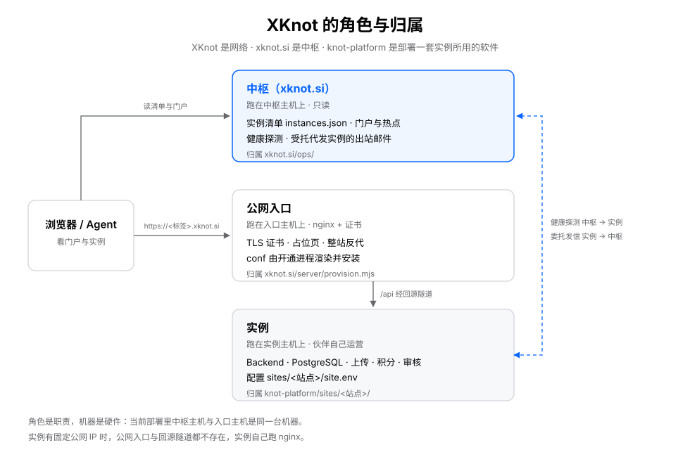

# XKnot 的概念与归属

一句话：**XKnot 是网络，`xknot.si` 是中枢，`knot-platform` 是部署一套实例所用的软件。**

## 角色与归属

| 角色 | 是什么 | 归属 |
|------|--------|------|
| **中枢** | `xknot.si` 上的只读入口服务：实例清单、门户、健康探测、热点橱窗、委托发信 | `xknot.si/` |
| **中枢主机** | 跑中枢的那台机器，主机名固定 `xknot.si` | `xknot.si/ops/` |
| **实例** | 一套独立部署的 Knot：自己的库、账号、积分、审核、上传 | 伙伴自己 |
| **实例主机** | 跑实例 Backend、Postgres 与上传目录的那台机器 | `knot-platform/sites/<站点>/` |
| **公网入口** | 给实例域名用的 nginx：证书、对外 HTTPS、占位页与公开快照、整站反向代理 | 中枢，`xknot.si/server/provision.mjs` 渲染 |
| **入口主机** | 跑公网入口的那台机器 | 同上 |
| **回源隧道** | 实例主动连出的 SSH 反向隧道，把入口主机的回环端口接到实例 | `sites/<站点>/tunnel.env` 的 `KNOT_TUNNEL_*` |

**入口按范围分两处存放**，这不是两个概念，是同一件事的两种粒度：

| 位置 | 放什么 | 换个实例还能用吗 |
|------|--------|------------------|
| `xknot.si/server/provision.mjs`、`ops/provision-worker.mjs` | 占位页、静态根、nginx conf、证书、隧道账号与 sshd 段的渲染，以及安装与核对 | 能 → 是软件 |
| `xknot.si/ops/entry/` | 某个已签发子域需要人工维护的 conf 与接通 runbook（如 `<子域>.xknot.si.conf`） | 不能 → 是这次签发的记录 |

## 一台机器可以兼任

角色是职责，机器是硬件。**同一台机器可以同时是中枢主机和入口主机**，当前部署就是这样：中枢站点与各实例的入口落在同一台主机上。

但归属按角色分，不按机器分：

- 中枢的配置只放 `xknot.si/ops/`；
- 入口的配置：已签发子域的 conf 由开通进程渲染并安装，人工维护的例外放 `xknot.si/ops/entry/`；实例这一侧不写入口主机上的任何文件；
- 实例自己的配置只放 `sites/<站点>/site.env`、`platform.env` 与开通流程写下的 `tunnel.env`。

两个项目互不引用对方的文件，只通过 HTTP 契约与接入件相连。所以「这台机器上还跑着中枢」不是实例部署的依赖，反过来也不是。

## 入口这一层什么时候不存在

**联邦成员一律走入口主机 + 回源隧道。** 名册 `mode` 只有一个取值 `subdomain`，`tunnel` 必填；清单 `url` 必须是中枢签发的 `https://<标签>.xknot.si`。接入方式见 [xknot.si/docs/JOIN.md](../xknot.si/docs/JOIN.md) 第 2 节。

实例如果**用自己的域名**对外，它就不需要加入联邦这一步：没有入口主机，也没有回源隧道，DNS 直接指向实例主机，实例自己跑 nginx、自己签证书。这类站点不登记 `instances.json`，也不参与联邦探测。

**「子域指到伙伴自己的固定 IP、不走隧道」不在契约里**：`validate-federation.mjs` 会拒绝，也没有落地步骤。要固定 IP 就用自有域名自建站点。

## 不要再用这些词

| 不写 | 为什么 |
|------|--------|
| 边缘、云端边缘、边缘主机 | 既像 CDN 边缘节点，又常常和中枢同机；读者分不清说的是中枢还是入口 |
| 节点 | 暗示点对点网络；应用「实例」 |
| 子站、分站 | 暗示从属副本；每个实例各有主权，应用「实例」 |
| 中心、总站、主站、聚合平台 | 与成员自治相反；应用「中枢」 |

## 往下读

| 想知道 | 看 |
|--------|----|
| 术语、禁用词、标准句子 | [xknot.si/docs/NAMING.md](../xknot.si/docs/NAMING.md) |
| 中枢与实例的契约 | [xknot.si/docs/FEDERATION.md](../xknot.si/docs/FEDERATION.md) |
| 中枢怎么跑、怎么验收 | [xknot.si/docs/HUB.md](../xknot.si/docs/HUB.md) |
| 实例怎么部署、隧道怎么配 | [knot-platform/README.md](../knot-platform/README.md)、[`knot-platform/ops/README.md`](../knot-platform/ops/README.md) 第 4 节 |
