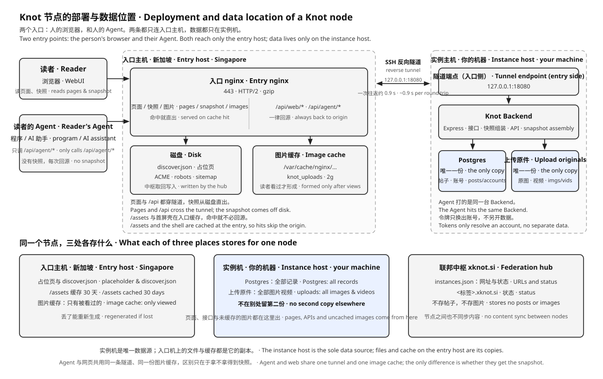

# xknot.si subdomain entry

This directory belongs to the **instance side** of deployment and serves one public shape only: the **sub-subdomain issued by xknot.si** (`<label>.xknot.si`).

One entry = one subdomain:

```text
sites/<site>/site.env                instance identity, entry host, tunnel
sites/<site>/entry.<label>.xknot.si.env  this subdomain's static root, conf, cert, serve mode
```

The repo carries no domain-specific conf: the entry is rendered from site config, and the domain and cert belong to whoever holds that instance.
Self-built domains, a fixed public IP direct connection, and direct intranet exposure are all outside the official deployment scope; customize yourself when needed.

**This directory holds templates only, not the finished conf of an already-issued subdomain.** The one the hub installs for partners (domain-hardcoded conf and the
join runbook) lives in the hub repo's [`xknot.si/ops/entry/`](../../../xknot.si/ops/entry/). How to judge: reusable on another instance → this directory; hardcoded to a subdomain → over there.

## What lives in each of the three places

A node spans three logical locations: the reader's browser, the Singapore entry host, and the instance host. The static files and image cache on the entry host are all **copies**; Postgres and the original uploads exist only on the instance machine; the federation hub records only the URL, not the content.



**Two entries, one back-origin.** A person's browser fetches `/`, `/assets/`, `/discover.json`, all on the entry disk; a person's Agent only calls `/api/agent/*` (`Authorization: Bearer <token>`), the entry has no copy of it, every call is a cross-border round trip. Both share the same tunnel, the same Backend, and the same image cache; the only difference is that the Agent can't get the public snapshot — it has no "draw a first screen" step to save.

| Entry | Fetches what | Goes through the tunnel |
|------|--------|------------|
| Browser | pages, `/discover.json`, `/assets/` | no, entry disk |
| Browser | `/api/web/*` | yes (`/api/web/home` brings back session and personal state at once) |
| Browser / Agent | `/api/web/uploads/…` | first time yes, then cache hits |
| Agent | `/api/agent/*` | every time |

`/api/agent` is not on the entry's 404 list (that's `/api/admin` and `/admin`), so it's publicly reachable; it only trusts tokens, not web sessions, so the fact that the entry machine has no database doesn't drop a validation layer — validation happens on the instance machine.

Directories, back-origin ports, and cache zones are independent per subdomain; installing a second node doesn't overwrite the first.

## Files in this directory

| Path | Purpose |
|------|------|
| `site.conf.template` | the nginx config for one xknot.si subdomain entry (rendered by overlaying the entry file onto `site.env`) |
| `log.conf.template` | the entry access-log format `knot_json`, declared once per entry host |
| `cache.conf.template` | the entry upload cache zone, declared once per entry host |
| `sshd-tunnel.conf.template` | the sshd Match block for the entry tunnel account (variable-ized) |
| `sshd-knot-tunnel.conf` | an explainer: why no finished file, how to render per subdomain (don't copy verbatim) |
| `realip.conf` | restores the real client address when the entry sits behind Cloudflare (`set_real_ip_from` + `real_ip_header`) |

Issuing, handing off, and accepting a subdomain belong to the federation hub, not this directory: [`xknot.si/docs/HANDOFF.md`](../../../xknot.si/docs/HANDOFF.md).

## Configuration

```bash
# sites/<site>/site.env — instance level
KNOT_ENTRY_ENABLED=1
KNOT_ENTRY_SSH=ec2-user@<entry host>
KNOT_PUBLIC_ORIGIN=https://<label>.xknot.si
KNOT_DOMAIN=<label>.xknot.si
KNOT_TUNNEL=1
KNOT_TUNNEL_SSH=knot-tunnel-<id>@<entry host>
KNOT_TUNNEL_KEY=$HOME/.ssh/knot-entry
KNOT_ENTRY_PROXY_PORT=18080
```

```bash
# sites/<site>/entry.<label>.xknot.si.env — one per subdomain
KNOT_DOMAIN=<label>.xknot.si
KNOT_ENTRY_WEB_ROOT=/var/www/<id>
KNOT_ENTRY_CONF=/etc/nginx/conf.d/<label>.xknot.si.conf
KNOT_ENTRY_SERVE=static        # or proxy
```

The entry file is an **overlay**: only write the items that differ from `site.env`, inherit the rest. The filename must equal the `KNOT_DOMAIN` inside, and the domain must be an xknot.si-issued sub-subdomain; `config.mjs check` blocks otherwise.

`KNOT_ENTRY_WEB_ROOT` and `KNOT_ENTRY_CONF` are the exception: each entry must write them out. When two subdomains on the same entry host share `/var/www/knot` or `conf.d/knot.conf`, a later `rsync --delete` clears the earlier one's static root and `cp` replaces its config. `push-entry.sh` therefore rejects empty values, relative paths, and sharing those two defaults.

## Serve mode: `static` or `proxy`

Both are rendered by the same template, differing only in `KNOT_ENTRY_SERVE`:

| | Where the home page and `/assets/` come from | When to use |
|---|---|---|
| `static` | the entry host's disk `KNOT_ENTRY_WEB_ROOT` | long-term. Static direct-serve, first screen doesn't cross the tunnel |
| `proxy` | the Backend tunneled back to `127.0.0.1:<back-origin port>` | when the release package hasn't reached the entry host yet, so pages and APIs don't version-drift |

`proxy`'s benefit is pages and APIs always from the same build; its cost is every static file crossing the tunnel. The 404 for `/api/admin` and `/admin`, the `/api/web/uploads/` cache, and the ACME directory are the same in both modes; only "where the home page and static assets come from" differs.

## Access log

Both modes write `/var/log/nginx/knot-access.log`, format `knot_json` (`log.conf.template`). The goal is to let the hub split each subdomain's traffic by `$host`, see `xknot.si/docs/HUB.md` §11.

- `log_format` can only be declared once, so it's a separate `knot-log.conf`, installed by `push-entry.sh` into the conf directory; **do not** write it into `site.conf.template`, or installing a second subdomain fails `nginx -t` on the duplicate definition.
- Only `$uri`, no query string: share tokens and search terms shouldn't enter the log.
- The file rotates with the default `/etc/logrotate.d/nginx` (matches `*.log`); the `knot-` prefix keeps it from mixing with other projects.
- The hub's traffic aggregation service reads this file; when the log is `0640 root:adm`, add that service's user to the `adm` group.

## Real client address

When the entry sits behind Cloudflare, `$remote_addr` is by default the CF edge address; writing it straight into `X-Real-IP` and `X-Forwarded-For` leaves the backend's per-IP rate limiting, bans, and audit with nothing but "one CF range".

- `realip.conf` declares `real_ip_header CF-Connecting-IP` and CF's own ranges; `push-entry.sh` installs it as `knot-realip.conf` in the conf directory, passing `nginx -t` together with `site.conf`.
- Trust only CF ranges: `CF-Connecting-IP` sent from elsewhere isn't trusted, forging this header can't change `$remote_addr`.
- Declared at the http level, one per entry host; **do not** write into `site.conf.template`, each subdomain writing its own would only overwrite each other.
- The ranges are copied from <https://www.cloudflare.com/ips-v4> and `/ips-v6`; missing a new range only means new-range clients still show the edge address, not that the config breaks.

## The entry home page is not a build artifact

`web/dist/index.html` is an SPA shell: `<title>Knot</title>`, nothing in `#app`. Pushed straight up, search indexing, social-platform previews, and non-JS crawlers get not a word.

In `static` mode, `push-entry.sh` calls `ops/scripts/entry-html.mjs` after rsync, generating the pages from `sites/<site>/profile.json`, then ships them to the entry host:

| File | Contents |
|------|------|
| `index.html` | `title`, `description`, canonical, Open Graph, Twitter Card, `WebSite` JSON-LD, `<noscript>` intro; `#app` and the asset references from the build output kept verbatim |
| `discover.html` | the feed's own shell: canonical `https://<host>/discover`, `CollectionPage` JSON-LD, feed copy and `<noscript>` fallback; never canonicalises back to `/` |
| `robots.txt` | allows pages, blocks `/api/` and `/admin`, points at the sitemap |
| `sitemap.xml` | only lists the two real static pages `/` and `/discover` |

- After the site name, intro, or logo changes, re-push the entry once, no rebuild needed.
- The profile's `locale` decides `lang`; old profiles without this field infer once by whether the copy contains CJK characters (the migration script writes it in, so no re-inference after).
- `npm run build:web` also emits `web/dist/discover.html` with a relative canonical (`/discover`). It is what `proxy` mode and local builds serve; the push-time version only overrides it with site-specific text and an absolute URL.
- `proxy` mode doesn't run the entry step: pages come from the origin-fetching Backend, changing files on the entry disk is useless.

### Unknown paths are 404, not the home page

In `static` mode the SPA shell is served only for the routes the WebUI actually defines: `/`, `/discover`, `/store`, `/economy`, `/activity`, `/delegate`, and the account pages `/mine`, `/mine/submissions`, `/notifications`, `/stars`, `/friends`. Every other path is a real 404. The old `try_files $uri $uri/ /index.html` answered 200 with the home page for any typo, which search engines read as an unbounded set of valid pages (soft 404); `/help` is not an exception — the Agent guide lives on the hub at `xknot.si/knot-help`.

Account pages keep their shell on refresh but carry `X-Robots-Tag: noindex, nofollow`; a crawler has no session, so indexing them would only file a login page. `Backend` sends the same header in `proxy` mode.
- The generated files go into `/var/www/<id>` together with `web/dist`; `/discover.json` and `/media/` are still pushed separately by `push-discover.sh`, never overwriting each other.

## Landing (entry host)

1. **Tunnel account**: create the system user `knot-tunnel-<id>`, key-only login; `authorized_keys` holds only the instance side's public key. The private key stays out of the repo. One account and one port per subdomain.

2. **sshd**: render [`sshd-tunnel.conf.template`](./sshd-tunnel.conf.template) then drop into `/etc/ssh/sshd_config.d/` (the main config must already have `Include /etc/ssh/sshd_config.d/*.conf`):

   ```bash
   KNOT_TUNNEL_USER=knot-tunnel-<id> KNOT_ENTRY_PROXY_PORT=18080 \
     node ops/scripts/render-config.mjs ops/entry/sshd-tunnel.conf.template /tmp/sshd-tunnel.conf
   sudo install -m 644 /tmp/sshd-tunnel.conf /etc/ssh/sshd_config.d/knot-tunnel-<id>.conf
   sudo sshd -t && sudo systemctl reload sshd
   ```

   Confirm `Match User knot-tunnel-<id>` takes effect and `PermitListen` only has `127.0.0.1:<back-origin port>`.

3. **Static root**: `sudo mkdir -p /var/www/<id>`, optionally place a placeholder `index.html`.

4. **Certificate**: first enable only `:80` + `/.well-known/acme-challenge/` (webroot pointing at the static root), then bring up 443 after signing.

   ```bash
   sudo certbot certonly --webroot -w /var/www/<id> -d <label>.xknot.si
   ```

5. **nginx**: `push-entry.sh` renders and installs from the template, no handwriting. For manual verification:

   ```bash
   ./ops/scripts/push-entry.sh --site <site> --no-build
   ```

6. **Regression**: the entry host may host several projects at once; reload only after `nginx -t` passes, and confirm the other `server_name`s on the same machine still work.

## Tunnel (instance host)

The instance dials out, forwarding the entry's loopback port to the local Backend:

```bash
./ops/scripts/run-entry-tunnel.sh
```

That is, one resident:

```bash
ssh -N -i ~/.ssh/knot-entry \
  -o ExitOnForwardFailure=yes -o ServerAliveInterval=30 -o ServerAliveCountMax=3 \
  -R 127.0.0.1:<back-origin port>:127.0.0.1:8080 \
  knot-tunnel-<id>@<entry host>
```

macOS keeps it resident with [`../launchd/entry-tunnel.plist`](../launchd/entry-tunnel.plist); other systems use systemd or equivalent. The key is auto-reconnect on drop.

### Don't let a system-level VPN take over this tunnel

The tunnel dials out from the instance, over the instance's own egress. If Cloudflare WARP (or another global TUN) is on the instance, TCP to the entry host gets taken over: the handshake drops from two hundred milliseconds to over a second, the SSH session gets reset, the LaunchAgent restarts repeatedly, and it shows as `/api/*` two seconds one moment and 502 the next. On the entry host's `sshd`, the tunnel source becoming a Cloudflare egress like `104.28.x.x` is the tell.

Diagnose:

```bash
# Instance: the path to the entry host should go over the physical NIC, not utun*
route get <entry host IP>

# Instance: which interface actually carried the traffic — a TUN cannot fake this
ops/scripts/egress-check.sh --url https://<site>/api/health

# Entry host: the source should be the instance's public IP
sudo journalctl -u sshd --since "-10 min" | grep "Accepted.*knot-tunnel"
```

`route get` only says where packets would go. Once the split tunnel is in place it does point at the physical NIC, and it keeps pointing there even after a rule is missed or another TUN inserts a more specific route ahead of the default — by then the traffic is already inside that tunnel. The interface byte counters are the only witness: `egress-check.sh` snapshots them around one request and names the interface that grew. It exits `3` when the egress is a tunnel interface, so it can gate a deployment.

**The right fix is to add the entry host IP to WARP's split tunnel**, so it never enters the tunnel in the first place:

```bash
warp-cli tunnel ip add <entry host IP>      # written into the local WARP config, survives restart
warp-cli tunnel ip list | grep <entry host IP>
```

After adding it to the split, **don't also bind `BindInterface`** in `~/.ssh/config`. Using both produces another symptom: TCP connects, `nc` can read the `SSH-2.0-OpenSSH_…` banner, but the key-exchange packets can't get through, and `ssh` hangs without error. Then launchd thinks the tunnel is alive, and `/api` doesn't fail-fast-and-reconnect but 502s wholesale:

```bash
# Symptom: banner there, ssh hanging
nc -w 6 <entry host IP> 22 < /dev/null | head -1
ssh -vv -i <tunnel private key> -o ConnectTimeout=8 <tunnel account>@<entry host IP> echo ok

# Keep only the timeout, drop BindInterface
Host <entry host IP>
    ServerAliveInterval 30
    ServerAliveCountMax 3
```

`run-entry-tunnel.sh` carries `-o ConnectTimeout=15`: should the handshake hang again, it exits on its own and lets launchd reconnect, not holding the slot forever.

### Reuse connections on back-origin

`ssh -R` costs one more cross-ocean round trip per new TCP (open channel + connect backend); the entry nginx by default opens a new one per request, so one `/api` request is two round trips. The template's `upstream knot_entry_<port>` sets `keepalive`, consecutive requests within the same second share one connection, measured from 0.8s down to 0.22s.

`keepalive_timeout` is deliberately pushed under Node's `keepAliveTimeout` (default 5s): idle past it, nginx drops the connection first, never colliding with the exact moment the Backend closes its idle connection. So pausing then clicking makes the first request slow a beat (re-establishing the channel), the rest fast again.

## Acceptance

```bash
# On the entry host, the back-origin port should be held by the tunnel account
ss -lntp | grep <back-origin port>

# Public
curl -sI https://<label>.xknot.si/
curl -s https://<label>.xknot.si/api/health

# The home HTML should carry the site name and intro, not just <title>Knot</title>
curl -s https://<label>.xknot.si/ | grep -E '<title>|og:description|<noscript>'
curl -s https://<label>.xknot.si/robots.txt
curl -s https://<label>.xknot.si/sitemap.xml

# The template already enables gzip and HTTP/2, these two must match
curl -s --http2 -o /dev/null -w '%{http_version}\n' https://<label>.xknot.si/
curl -s --http2 -H 'Accept-Encoding: gzip' -o /dev/null -D - \
  https://<label>.xknot.si/assets/<home-referenced js> | grep -i content-encoding
```

`/` should return the static page in `static` mode; `/api/*` returns 502 when the tunnel is down.

`discover.json` is `try_files` disk-first then tunnel, so the entry disk can't keep an old snapshot — keep one and it never falls back.
`push-discover.sh` pushes this one copy.

**Pages and APIs from the same build** is what counts as acceptance passing — looking only at `/api/health` misses "API new, pages old":

```bash
./ops/scripts/speed-check.sh https://<label>.xknot.si/ https://<label>.xknot.si/api/health
# then compare the home-referenced assets/index-*.js against /api/health's release
```

## Security

- The entry 404s `/api/admin` and `/admin` directly, not tunneled through.
- `PermitOpen none`, `PermitTTY no`, `ForceCommand sleep infinity`: the tunnel account can't open a shell or do forward forwarding.
- Keys, passwords, and PEMs stay only in each machine's `~/.ssh/` and private environments, never in docs or the repo.
