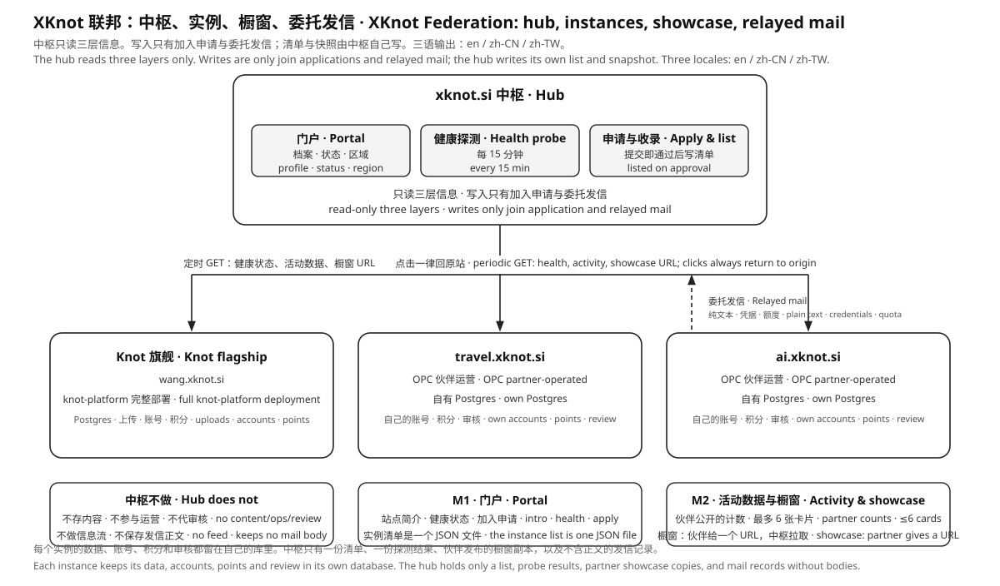

# XKnot Federation

`xknot.si` is the hub of the XKnot Federation. **The XKnot Federation — a decentralized, distributed information network for the AI and Agent era.**

The hub holds three kinds of information: **site profiles, runtime status, and showcases**. It does not store instances' users, content, points, review, or billing — those all live in each instance's own deployment.

Joining is application-based: first deploy a Knot on your own machine, fill in the profile and pick a subdomain in its admin UI (the XKnot section of `/admin`), and submit. The platform checks and issues the subdomain on the spot — **submission is approval**. The hub then automatically completes the account, certificate, and reverse proxy on the entry host; the instance brings up the tunnel itself, and once `/api/health` passes, the entry's `status` becomes `active`. An application never automatically changes any already-listed entry.

- Names and bilingual wording: [docs/NAMING.md](docs/NAMING.md)
- Contract and fields: [docs/FEDERATION.md](docs/FEDERATION.md)
- System architecture: [docs/ARCHITECTURE.md](docs/ARCHITECTURE.md)
- Locale and region: [docs/I18N.md](docs/I18N.md)
- Implementation and deployment: [docs/HUB.md](docs/HUB.md)
- Local deployment and end-to-end testing: [docs/E2E.md](docs/E2E.md)
- Joining: [docs/JOIN.md](docs/JOIN.md)
- Agent interface guide (federation-wide; the source text lives in the repo root [`docs/KNOT_HELP.md`](../docs/KNOT_HELP.md)): published at <https://xknot.si/knot-help>



## Topology

The roster data lives in [`federation.json`](federation.json): who the founding instances are, how subdomains come about, how to connect, and the tunnel accounts and ports. The table below is just one view of it; change the roster first, then keep this section in sync.

| Subdomain | Identity | Role |
|------|------|------|
| `xknot.si` | hub | instance manifest, profile, health dot, region filter |
| `wang.xknot.si` | founding instance | the instance of the XKnot project founder, a permanent account not subject to delisting; `tier=paid` |
| `cpswang.xknot.si` | founding instance | the founder's international site and the flagship implementation demo, a permanent account not subject to delisting; `tier=paid` |

`xknot.si` is the federation portal itself; the other subdomains are **instances**, each running a Knot instance (the current implementation is `knot-platform`, with WebUI, Backend, and the OpenClaw companion): its own Postgres, upload directory, accounts, points, and review. Instances do not share sessions, user tables, or balances. Each instance talks only to the portal, and the portal is read-only. Connecting depends on only two things: `/api/health` and the access material issued by the hub — independent of what software an instance runs or how it deploys. How a site describes itself is written by its owner in the instance's `/admin`; the hub fetches it via `GET /api/federation/profile`, with no submission or approval required.

## Principles

1. **Instances are autonomous.** Data, accounts, points, review, and billing belong to the instance.
2. **The hub is read-only.** The network view does not write to instances; the only data-side write entry is the join application, and once it is approved a resident worker writes it into the manifest and connects it automatically. There is also delegated mail, which only hands a message to SMTP and changes no data.
3. **Entries link back to their origin.** Every entry and every showcase card links back to the source site.
4. **Data is split into three parts, each managed separately.** `instances.json` records only hub-issued fields (`id`, `url`, `since`, `tier`, `status`, `statsUrl`, `cardsUrl`); a site's name, description, and contact are written by the owner in their own instance, and the hub fetches a copy into `var/profiles/`; `federation.json` records membership identity and connection facts (who is in, what role, how the subdomain comes about, tunnel account and port). The manifest and the roster are cross-checked against each other; a mismatch stops the build.

## What the hub provides

| Layer | Capability | Content |
|----|------|------|
| L1 | site profile | issued zone (hub-written: `id`, `url`, `since`, `tier`, `status`) + self-described zone (owner-written in the instance: name, one-line tagline, intro, logo, owner, contact, region, timezone, tags) |
| L2 | runtime status | probes `/api/health` at build time, giving the health dot, last-ok time, and availability |
| L2 | activity data | optional. When an instance gives a `statsUrl` in the manifest, the build fetches window counts, labeled "data shared by the partner" on the page; without it there is no such layer and the portal shows nothing |
| L3 | showcase | optional. When an instance gives a `cardsUrl` in the manifest, the build fetches it, up to 6 cards, each opening back on the origin site; without it the showcase area falls back to empty |
| — | portal | trilingual static site; left column with the world map and a card-based instance directory (filterable by region, online, showcase), right column with the member entry and a four-step join guide |
| — | application and listing | applications submitted on behalf of an instance are stored, auto-approved, and issued a subdomain, with mail notifications, a console overview, and manifest entries |
| — | mail relay | an instance delegates a plain-text notification to the hub's SMTP via a Bearer credential, with its own quota and send log |
| — | entry traffic | the hub aggregates requests and bytes per subdomain from the entry nginx logs, shown only in the console, requiring no cooperation from the instance |

## Language and region

| Item | Convention |
|----|------|
| Locale | `en` (default, required), `zh-CN`, `zh-TW`, the same set as the WebUI |
| Fallback | this locale → its base language → `en` → the first non-empty locale in the manifest, computed per field |
| URL | path prefixes `/en/`, `/zh-CN/`, `/zh-TW/`, with `hreflang` and `x-default` |
| Region | ISO 3166-1 alpha-2, the place the service targets |
| Grouping | global, East Asia, Southeast Asia, South Asia, Central Asia, Middle East, Europe, North America, Latin America, Africa, Oceania, other |
| Language detection | by path prefix; no GeoIP requests |

Language and region are independent: locale is the UI text's path prefix, while region is the `region` in the site profile (ISO 3166-1 alpha-2) and the portal's grouping; neither is derived from the other. The site's self-description is a single-value field, not split by locale. Rules in [docs/I18N.md](docs/I18N.md).

## Implementation milestones

| Milestone | Scope |
|--------|------|
| M1 | manifest and validation, Vue trilingual portal, L1 profile, L2 health probe, region filter |
| M2 | L3 showcase fetch, L2 activity data, portal showcase slot |
| M3 | join application, console, admin accounts, application-generated manifest entries |

The network view remains static files; probing and fetching all happen at build time. The only long-running parts are the API process (accepting applications, storing application state, issuing admin sessions) and a 15-minute patrol timer (disconnect reminders, temporary hiding).

## Directory

```text
xknot.si/
├── README.md              this file: federation entry and principles
├── package.json           this project's scripts: dev / build / test / deploy / admin
├── instances.json         instance manifest: portal-facing fields (console edits operational fields)
├── federation.json        federation roster: membership identity, access mode, tunnel account and port
├── fixtures/              layout samples: ten partner entries and showcases, merged only into --preview builds
├── server/                API: application, admin, manifest entries (SQLite, no external deps)
├── admin/                 console static pages: overview and application records, under /admin/
├── docs/
│   ├── NAMING.md          naming conventions: bilingual wording, forbidden words
│   ├── I18N.md            i18n and region: locale, fallback, region grouping
│   ├── FEDERATION.md      the contract between hub and instance
│   ├── ARCHITECTURE.md    the system map: roles, planes, state, failure modes
│   ├── HUB.md             the hub's implementation, operation, and acceptance
│   ├── E2E.md             local deployment shape, test layers, coverage matrix
│   ├── JOIN.md            joining: application, domain, and tunnel
│   ├── federation.svg     architecture diagram
│   └── architecture.svg   system map diagram
├── e2e/                   end-to-end tests: API/mail with node --test, pages with Playwright
├── ops/
│   ├── xknot.si.conf      nginx config for the portal and API
│   ├── dev.mjs            starts API and Vite together
│   ├── local-hub.mjs      local entry: static site and /api /admin reverse proxy (mirrors nginx)
│   ├── local-stack.mjs    local deployment orchestration: API + entry, also used by e2e to start the stack
│   ├── deploy-local.sh    one-shot local deployment: validate, build, start
│   ├── check-health.mjs   health probe, writes var/health.json
│   ├── watch-health.mjs   patrol: 24h reminder, 7d hide, auto-recovery
│   ├── xknot-health.service / .timer  systemd timer (every 15 minutes)
│   ├── traffic.mjs        entry access log → per-subdomain daily traffic, writes var/traffic/{id}.json
│   ├── node-status.mjs    synthesizes node status (probe + tunnel + location + traffic), writes var/status.json
│   ├── xknot-traffic.service / .timer  systemd timer (hourly)
│   ├── republish.mjs      recomputes the portal snapshot at runtime: updates data/hub.json after a connect or profile revision
│   ├── xknot-republish.service / .timer  systemd timer (every 10 minutes)
│   ├── fetch-cards.mjs    showcase fetch, writes var/cards/{id}.json
│   ├── fetch-stats.mjs    activity data fetch, writes var/stats/{id}.json
│   ├── build-hub-data.mjs merges manifest, probes, activity data, and showcase, writes data/hub.json
│   ├── doc-page.mjs       shared doc page: markdown → single-page HTML + raw text
│   ├── build-hub.sh       local build: validate, probe, fetch, build, write snapshot
│   ├── build-world-dots.mjs  generates the world base map (web/src/lib/world.js)
│   ├── deploy-hub.sh      optional static site sync (target given by env vars)
│   ├── deploy-api.sh      sync of hub API, console, and site config
│   ├── README-deploy-aws.md  deployment notes for the hub hosting host
│   ├── validate-instances.mjs  manifest validation
│   └── validate-federation.mjs roster validation (cross-checked with the manifest)
├── var/                   generated: probe results, application DB, session secrets (not in version control)
└── web/                   Vue portal, installed and built independently
    ├── package.json       its own deps and scripts
    ├── vite.config.js     trilingual entries, dev data middleware, /api and /admin proxy
    ├── index.html         / redirect
    ├── en/ zh-CN/ zh-TW/  the three HTML entries
    ├── public/logos/      hub mark and instance LOGOs
    ├── src/               Vue source: App, components (map, cards, member login), lib, locales
    └── dist/              build output (not in version control)
```

`xknot.si` is itself an independent project: the root manages scripts, the manifest, and the API, while `web/` manages the pages, with dependencies installed only in `web/node_modules`. It does not join `knot-platform/`'s `workspaces`, does not import `knot-platform/*` code, and does not depend on any process on bot01. The dev environment is this machine, requiring Node 22 or newer (the API uses `node:sqlite`, keeping no external database dependency).

```bash
cd xknot.si
npm run dev      # API 5181 + portal dev server 5180
npm run build    # validate, probe, build, write snapshot
npm run deploy:local                 # run in production shape locally: API + entry, Ctrl-C stops both
npm run test     # unit tests (manifest, roster, pages, API, mail)
npm run test:e2e # API end-to-end: real HTTP, SQLite, SMTP sessions, and CLI
npm run test:ui  # browser end-to-end: portal, member login, console (install e2e deps first)
npm run admin -- create-admin paul   # create an admin account
npm run mail:test -- you@example.com # send a test mail using SMTP_*
npm run deploy:api                   # deploy API and console (requires XKNOT_HUB_SSH)
```

Deployment is split into two independent commands: `npm run deploy` syncs the static site, `npm run deploy:api` syncs the API, console, and site config. Both honor only env vars like `XKNOT_HUB_SSH`; there is no default host in the repo.

The console is at `http://127.0.0.1:5180/admin/`; after login, start with the overview (instances and probes, application records, mail, recent events), then switch to "application records". In the overview, clicking an instance lets you edit the **issued zone** and roster fields in place; saving writes back to `instances.json` and `federation.json` (whole-file validation first; nothing is written on failure). The self-described zone only shows the fetched copy; changes go to the instance's own `/admin`. Application data is in `var/xknot.db`, backed up together with the two JSON files.

| File | Content |
|------|------|
| [docs/NAMING.md](docs/NAMING.md) | naming conventions: bilingual wording, forbidden words, code identifiers |
| [docs/I18N.md](docs/I18N.md) | i18n: locale, fallback chain, region grouping, URLs, and acceptance |
| [docs/FEDERATION.md](docs/FEDERATION.md) | contract: L1 fields, L2 determination, L3 showcase format, listing and delisting |
| [docs/ARCHITECTURE.md](docs/ARCHITECTURE.md) | the system map: roles, three planes, state ownership, failure modes |
| [docs/HUB.md](docs/HUB.md) | the hub's implementation, run shapes, and acceptance checklist |
| [docs/E2E.md](docs/E2E.md) | local deployment shape, test layers, coverage matrix, and troubleshooting |
| [docs/JOIN.md](docs/JOIN.md) | joining: application flow and access shape (issued subdomain + entry tunnel) |
| [docs/HANDOFF.md](docs/HANDOFF.md) | listing handoff sheet: steps from issuance to connection, and acceptance |
| [docs/PARTNER-MAIL.md](docs/PARTNER-MAIL.md) | mail templates and sending rules for partners |
| [docs/BILLING.md](docs/BILLING.md) | billing: what the paid access subscription entitles, and who charges whom (plan, not implemented) |
| [docs/federation.svg](docs/federation.svg) | architecture diagram |
| [docs/architecture.svg](docs/architecture.svg) | system map diagram that accompanies ARCHITECTURE.md |
| [instances.json](instances.json) | instance manifest: issued-zone fields |
| [federation.json](federation.json) | federation roster: membership identity, access mode, tunnel account and port |
| [ops/xknot.si.conf](ops/xknot.si.conf) | nginx config for the portal |
| [ops/check-health.mjs](ops/check-health.mjs) | health probe, writes `var/health.json` |
| [ops/watch-health.mjs](ops/watch-health.mjs) | patrol: consecutive-disconnect reminders, temporary hiding, auto-recovery |
| [ops/fetch-profile.mjs](ops/fetch-profile.mjs) | fetches each instance's `/api/federation/profile`, writes `var/profiles/{id}.json` |
| [ops/build-hub-data.mjs](ops/build-hub-data.mjs) | merges manifest, profile copies, and probes, writes `data/hub.json` |
| [ops/republish.mjs](ops/republish.mjs) | recomputes only `data/hub.json` at runtime: called by the worker and timer after a connect or profile revision |
| [ops/doc-page.mjs](ops/doc-page.mjs) | shared doc page: markdown rendering, title/description extraction, HTML skeleton, shared by static docs |
| [ops/local-hub.mjs](ops/local-hub.mjs) | local entry: static site, security headers, and reverse proxy, mirroring nginx |
| [ops/local-stack.mjs](ops/local-stack.mjs) | local deployment orchestration: temp data dir, random port, start/stop |
| [ops/deploy-local.sh](ops/deploy-local.sh) | one-shot local deployment |
| [e2e/](e2e) | end-to-end tests: `*.e2e.test.mjs` and `browser/*.spec.mjs` |
| [ops/deploy-api.sh](ops/deploy-api.sh) | sync of hub API, console, and site config |
| [ops/build-hub.sh](ops/build-hub.sh) | local build: validate, probe, build, write snapshot |
| [ops/deploy-hub.sh](ops/deploy-hub.sh) | optional remote sync, target given by env vars |
| [ops/validate-instances.mjs](ops/validate-instances.mjs) | manifest validation; the build stops on failure |
| [ops/validate-federation.mjs](ops/validate-federation.mjs) | roster validation: enums, unique accounts and ports, one-to-one with the manifest |
| [web/src/lib/i18n.js](web/src/lib/i18n.js) | language parsing, per-field fallback, relative time |
| [web/src/lib/regions.js](web/src/lib/regions.js) | country code to region grouping |
| [web/src/lib/hub.js](web/src/lib/hub.js) | snapshot to page view |
| [web/src/lib/contact.js](web/src/lib/contact.js) | the ops contact name and email shown in the portal's right column |

The hub's code lives in this directory and is not merged into `knot-platform/`. Two other locations in the repo do not reference this project and are not referenced by it:

| Location | Content |
|------|------|
| [`knot-platform/`](../knot-platform) | **independent project**: the instance implementation, Backend, WebUI, and shared packages. This is what `xxx.xknot.si` runs today; swapping the implementation does not affect the hub |
| [`knot-platform/ops/`](../knot-platform/ops) | the instance's deployment, entry, backup, and patrol scripts; the subdomain entry templates live in `ops/entry/` |
| [`docs/`](../docs) | **root public assets**: copyright and trademark, LOGO master, API entry index, federation-layer docs; not part of the instance side |

The direction is one-way: the hub only probes an instance's `/api/health` using the manifest's `url`; it does not read the instance's code, database, or processes, and the instance does not change the hub's manifest. The two sides meet only through two contracts — the probe ([docs/FEDERATION.md](docs/FEDERATION.md) section 5) and the access material (section 7.4). Subdomain issuance and manifest listing are policies here ([docs/JOIN.md](docs/JOIN.md)); how the entry and tunnel are realized is the instance side's business ([`knot-platform/ops/entry/README.md`](../knot-platform/ops/entry/README.md)).

## Listing and billing

Listing is free and application-based. The portal's right column only does email → authorization-code login and a four-step guide, with no application form: the application is submitted on the instance's behalf from its own `/admin` XKnot section (`POST /api/admin/xknot/apply` → the hub's `POST /api/applications`). The hub checks and issues the subdomain on receipt (the application status is directly `approved`, with `reviewed_by` set to `auto`) and sends an approval letter. After that a resident worker writes the entry into `instances.json` and `federation.json` automatically and then completes the account, certificate, and reverse proxy; the instance brings up the tunnel itself, and once `/api/health` passes, `status` becomes `active`. New applications mail an alert to the admin; an application never automatically changes any already-listed entry. Founding instances (`wang`, `cpswang`) are permanent accounts not subject to delisting.

Federation members are either `free` or `paid`, defaulting to `free`; the operator upgrades to `paid` as needed; `demo` is only for layout samples. The tier lives in the manifest's `tier` field and only affects portal display and sorting, not the access method.

Billing does not happen in the hub. The `*.xknot.si` subdomain, deployment, upgrades, backups, and incident response are separate services; the hub handles no orders, no charges, and no revenue sharing.

Listing has a legal threshold: instances that are illegal, fraudulent, impersonating, or infringing trademarks are removed from the manifest; rules in [FEDERATION.md](docs/FEDERATION.md) section 9.

## Ownership and license

`xknot.si` and the subdomains issued under it belong to **PaulWang**. The code is released under [Apache-2.0](./LICENSE), copyright PaulWang, with attribution in [NOTICE](./NOTICE). This directory ships its own `LICENSE` and `NOTICE`, so taking it alone carries both the license text and the attribution.

- The license grants copyright and patent rights to the code, **not the trademark**. The names and marks `Knot`, `xknot`, and `xknot.si` are not licensed with the code.
- `*.xknot.si` subdomains are issued only by the rights holder. Self-deployed instances may use their own domain and may write "based on Knot", but must not imply official certification.
- Listing does not change ownership. A partner's site, content, and users belong to the partner.
