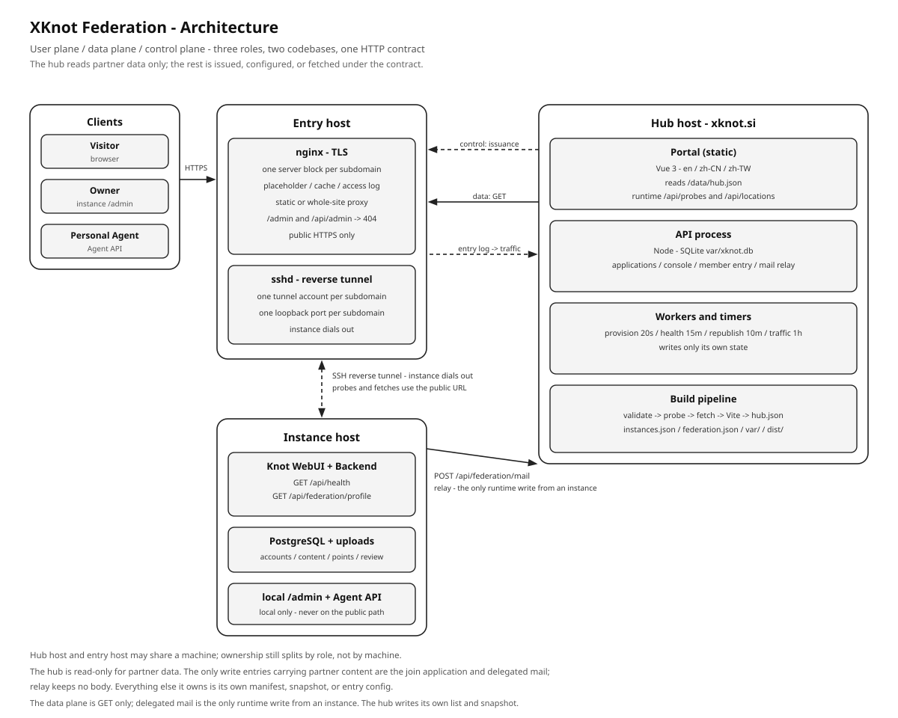

# XKnot Federation · Architecture

This is the system map, not the rulebook. Field-level rules are in [FEDERATION.md](FEDERATION.md), hub operation in [HUB.md](HUB.md), joining in [JOIN.md](JOIN.md), and wording in [NAMING.md](NAMING.md). This document answers four questions: what the parts are, which way data moves, who writes which file, and what happens when a part fails.

## 1. Shape in one page

The federation has three server-side roles and two independent codebases.

| Role | What runs there | Owns | Code |
|------|-----------------|------|------|
| **Hub** | Portal, API process, provisioning worker, timers, build pipeline | `instances.json`, `federation.json`, `var/`, `dist/` | `xknot.si/` |
| **Entry host** | nginx and sshd, one server block and one tunnel account per subdomain | TLS, static placeholder, cache, access log, loopback tunnel ports | rendered by `server/provision.mjs`; manual records in `xknot.si/ops/entry/` |
| **Instance host** | A Knot: WebUI, Backend, PostgreSQL, uploads | Accounts, content, points, review, orders, its own backups | `knot-platform/` |

Clients are not a fourth role: a browser reaches an instance through the entry, and a Personal Agent reaches the same Backend through the Agent API.

**A role is a responsibility, not a machine.** The current deployment runs the hub and the entry on the same host; ownership still splits by role. The hub's own nginx config belongs to `xknot.si/ops/`. An issued subdomain's conf is rendered by the provisioning worker and is the hub's issuance record; the instance side never writes it. Sharing a machine never merges the two.

Three planes cross these roles, and keeping them apart explains most of the design:

| Plane | Direction | Carries | Authentication |
|-------|-----------|---------|----------------|
| **User** | browser → entry → instance | sessions, content, uploads, the whole WebUI | the instance's own sessions and tokens |
| **Data** | hub → entry → instance, GET only | runtime status, site profile, showcase, activity counts | none: public, read-only addresses |
| **Control** | hub → entry over SSH; instance → hub over HTTPS | issuance, vhost, certificate, tunnel parameters, join progress, mail relay | operator credentials, case key, Bearer token |

The phrase "the hub is read-only" belongs to the **data plane**: the hub never writes partner content, accounts, or points. The hub does write its own manifest, caches, and snapshot, and it writes the entry configuration on the entry host. That is the control plane: it writes its own copies and configuration, never back into a partner's database.

## 2. Decisions that shape the system

| Decision | Why | Consequence |
|----------|-----|-------------|
| Members are autonomous; the hub reads | No shared database means no cross-instance permissions, migrations, or data custody | The only writes an instance initiates are its application and delegated mail; the hub writes its own manifest, caches, and snapshot |
| The address is the identity | One stable `url` per instance | Moving machines or networks changes DNS and the tunnel, never the `url`; changing the label is a re-issue, not a routine edit |
| The instance dials out | Instances often sit behind NAT with no fixed public IP | The entry holds the public IP and certificate; the hub never dials the instance directly, only its public URL; the instance initiates the tunnel |
| The portal is static; data is fetched out of band | A small attack surface and no partner-data database | Freshness is bounded by the build (showcase, counts) and the republish loop (manifest, profiles); runtime probes override the build-time health and region |
| State is split by owning role | Each zone has exactly one owning role | Manifest, roster, profile copies, probe results, and snapshot are validated and never co-written |
| The entry isolates per subdomain | Same host carries several instances | One tunnel account, one loopback port, and one conf per subdomain; auto-provisioned entries also keep their own cache zone and log format |
| Two codebases, HTTP contract only | The instance implementation is replaceable | No shared dependencies or imports; swapping `knot-platform` does not touch the hub |
| Degrade to the last good copy | A partner outage must not blank the portal | Failed fetches keep the previous file; stale showcases gray out and then hide; entries hide rather than disappear |

## 3. Components

### 3.1 Hub host

| Part | Form | Responsibility | State |
|------|------|----------------|-------|
| Hub nginx | nginx | Terminates TLS for `xknot.si`, serves the portal and `/data/hub.json`, proxies `/api/` and `/admin/` to the loopback API | `ops/xknot.si.conf` |
| Portal | Vue 3 + Vite static build | Trilingual directory, map, member entry, `/knot-help` | `dist/`, reads `/data/hub.json` |
| API | Node process on `127.0.0.1:5181` | Join applications, subdomain precheck, member login, console, mail relay | SQLite `var/xknot.db` |
| Console | Static pages + API | Overview, instance records, manifest and roster edits | `/admin/` |
| Provisioning worker | Resident process | Advances an approved application through issuance and acceptance | `var/xknot.db` provision runs |
| Timers | systemd timers | Health patrol, snapshot recompute, entry traffic aggregation | `var/health.json`, `dist/data/hub.json`, `var/traffic/` |
| Build pipeline | `ops/build-hub.sh` | Validate, probe, fetch, build, emit the snapshot and crawlable entry pages | `dist/`, `var/` |

The portal reads one snapshot, `/data/hub.json`, generated by the build. Two parts of that snapshot are samples from build time: each instance's `health` and its observed region. The page therefore fetches `/api/probes` and `/api/locations` at runtime and overrides only health and the observed region (plus a timezone inferred from that region). Everything else comes from the snapshot: the issued zone and self-described zone are refreshed by the republish loop, while showcase and activity counts refresh on the next build or fetch run. None of them change on page load.

The hub keeps an application and session database of its own. It keeps **no partner database**: no accounts, posts, orders, points, or uploads.

### 3.2 Entry host

The entry is the only public surface for an issued subdomain.

| Part | Responsibility |
|------|----------------|
| nginx, one `server` block per subdomain | Terminates TLS, serves or proxies `/`, proxies `/api/`, blocks `/api/admin` and `/admin` |
| Cache | Long cache for hashed `/assets/`, short cache for the page shell, one-day cache for uploads; auto-provisioned entries use a per-subdomain zone |
| Access log | One `access_log` directive per subdomain into the shared file; the query string is never logged; auto-provisioned entries declare their own `log_format` |
| sshd | One tunnel account and one permitted loopback port per subdomain |
| Disk | ACME challenge directory, placeholder page, `robots.txt` / `sitemap.xml`, `discover.json` snapshot |

One generator produces both stages of an issued subdomain:

- **before acceptance**: `/` serves the placeholder from the entry disk, `/api/` is already connected to the loopback port. The disk also holds the ACME challenge directory, `robots.txt`, `sitemap.xml`, and the public `discover.json` the hub fetches over the tunnel.
- **after acceptance**: the same generator rewrites `/` to reverse-proxy through the tunnel; the placeholder retires and the static root is left to ACME.

A conf is either hub-managed or hand-maintained. Automatic provisioning writes the first kind, with a managed mark on the first line; an ops-only manual conf writes the second, and the hub only rewrites confs it created. `node server/admin-cli.mjs entry-adopt <id>` takes over a hand-maintained conf: the original is kept as `<subdomain>.conf.adopted` and the worker checks the hub version from then on.

Entry traffic is a hub-side observation, not a federation layer: the hub aggregates this log per subdomain, shows it only in the console, and puts it into neither the snapshot nor the member entry.

### 3.3 Instance host

An instance is a complete Knot deployment: WebUI, Backend, PostgreSQL, upload directory, local `/admin`, and optional Personal Agents. Only the Backend accesses the database.

For the federation it exposes two read-only addresses:

| Address | Content | Required |
|---------|---------|----------|
| `GET /api/health` | `ok`, service, version, and the instance id when joined | yes, for acceptance and runtime status |
| `GET /api/federation/profile` | issued zone + the owner-written self-described zone | when joined |

The contract also defines optional `cardsUrl` and `statsUrl` endpoints for the showcase and activity counts. They are fetched only when the manifest sets them; no current entry does, and `knot-platform` does not publish them yet.

The instance's WebUI, sessions, accounts, points, and uploads stay on the instance host. The hub shows a copy of the profile, probe results, optional public cards, and activity counts; it never proxies a partner's session.

## 4. Flow

### 4.1 Build

`ops/build-hub.sh` runs one fixed order:

1. validate `instances.json` and `federation.json`, cross-checking them;
2. probe every `status: active` entry at `url` + `/api/health`, writing `var/health.json`;
3. fetch profile, showcase, and activity counts, each keeping its previous copy on failure;
4. install WebUI dependencies if needed and run the Vite build;
5. render `/knot-help` from the repository's single Markdown source;
6. merge everything into `dist/data/hub.json`, verified against the manifest;
7. write `robots.txt`, `sitemap.xml`, and the script-free instance directory.

`--offline` skips probing and fetching and reuses the existing `var/`; `--preview` merges layout samples from `fixtures/` without touching the real manifest.

### 4.2 Runtime loops

| Loop | Period | Reads | Writes | On failure |
|------|--------|-------|--------|------------|
| Provisioning worker | 20 s, plus step backoff | approved applications, probe results | manifest, roster, entry conf, certificate issuance, run state | records an error code and retries; `tls` stops after five attempts |
| Health patrol | 15 min | each active instance's `/api/health` | `var/health.json`, `var/status.json` | keeps the last result, increments the down timer, mails per the reminder and hide rules |
| Snapshot republish | 10 min, plus immediately after acceptance | manifest, probes, cards, stats; refetches profiles | `var/profiles/{id}.json`, `dist/data/hub.json` | a snapshot failing verification is not written |
| Entry traffic | 1 hour | entry nginx access log | `var/traffic/{id}.json`, then `var/status.json` | a missing log is skipped, no empty result written |

Health patrol never edits `instances.json`. It decides hiding after seven days offline and stores that in `var/health.json`; the portal only reads the flag, so recovery needs no reapplication.

### 4.3 Join to active

1. The owner fills the site profile and picks a subdomain in the instance's `/admin`; the instance submits the application with its public key.
2. The hub validates and approves on receipt; the worker then writes the manifest entry with `status: pending` and the roster member.
3. The worker finishes pre-staging: tunnel account and port, entry account and `authorized_keys`, static placeholder, subdomain conf, DNS check, certificate.
4. The instance reads its progress by case key, writes `tunnel.env`, starts the tunnel, and the probe reaches its Backend.
5. Once `/api/health` passes, the worker switches the entry to whole-site reverse proxy, sets `status: active`, and recomputes the snapshot.
6. The instance writes `xknot.env` and restarts the Backend; `/api/federation/profile` now has content.

The sequence and its failure checklist are in [JOIN.md](JOIN.md) and [HANDOFF.md](HANDOFF.md).

## 5. State ownership

| State | Writer | Readers | Loss behavior |
|-------|--------|---------|---------------|
| `instances.json` | hub worker, console, `publish` | build, worker, validation | source of truth for identity and acceptance; restore from backup |
| `federation.json` | hub worker, console, `publish` | validation, operations | roster only; not used for rendering |
| `var/health.json` | health scripts | build, republish, console | deleting it returns every entry to `unknown` |
| `var/profiles/{id}.json` | profile fetch | build, republish | missing copy falls back to issued-zone fields |
| `var/cards/{id}.json` | showcase fetch | build, republish | missing copy shows no showcase |
| `var/stats/{id}.json` | activity fetch | build, republish | missing copy shows "not shared" |
| `var/traffic/{id}.json` | traffic aggregation | console, status | missing file means "not collected" |
| `var/status.json` | status merge | console | recomputed by the next collector |
| `var/xknot.db` | API, worker, CLI | API, console, worker | applications, sessions, relay records, provisioning runs; back up with the two JSON files |
| `dist/data/hub.json` | build, republish | portal, crawler pages | last good snapshot stays; a failed verify blocks the write |
| Entry conf | hub worker or hand-maintained conf | nginx | last good conf stays until the next idempotent step |
| Instance database | instance Backend | instance only | the partner's own backup and recovery |

Two rules hold everywhere: one owning role per file (manifest and roster writers queue on a file lock), and atomic replacement (temp file + rename) for anything a reader may open at any moment.

## 6. Trust boundaries

- **Partner URLs are untrusted input.** Probes and fetches accept `https` only, follow no redirects, cap the response, and after DNS resolution reject loopback, private ranges, link-local, and cloud-metadata addresses.
- **No credentials travel with a fetch.** The hub sends no cookie and no token to a partner address; `cardsUrl` and `statsUrl` are public addresses by definition.
- **Only two write entries carry partner content or outbound mail**: the join flow (application and public key, length caps, rate limits, no file storage) and the mail relay (Bearer credential bound to one active instance, plain text, quota, no body retained).
- **The access material is a credential file.** It is written `0600`, kept in the instance's own configuration directory, and never enters the repository, chat, or logs. Revoking a relay credential or re-signing access material is the hub's recovery path.
- **Tunnel isolation is per subdomain.** One account and one permitted port each; sharing them would make the first matching sshd rule shadow the rest.
- **Admin surfaces stay off the public path.** The entry returns 404 for `/admin` and `/api/admin`; the hub console and the instance admin are loopback services behind their own sessions.
- **The portal runs no partner code.** No partner scripts, no iframes; external links carry `rel="noopener noreferrer"`.
- **Logs minimize.** Entry logs never keep the query string; aggregated traffic drops the IP entirely and keeps only the referer host; relay logs keep the recipient domain and an address hash, not the body.

## 7. Failure modes

| Failure | Still works | Degrades | Recovery |
|---------|-------------|----------|----------|
| Tunnel drops | the entry, the hub, the instance's local network | the subdomain's `/` and `/api` return the entry's error or stale cached shell | the instance reconnects; the probe clears `downSince` automatically |
| Instance is down | the portal, the entry, other instances | that entry shows `down`, then hides after seven days | back automatically on a successful probe |
| Profile fetch fails | the portal | the card falls back to issued-zone fields, or keeps the previous copy | next build or republish |
| Showcase fetch fails | the portal | the previous card group, then gray, then hidden | next fetch after the partner recovers |
| Activity fetch fails | the portal | previous counts, or "not shared" when there is no copy | next fetch after the partner recovers |
| Hub API is down | the static portal and the last snapshot | applications, member login, console, relay stop | restart the API; static pages stay up |
| Republish fails | the last snapshot | new instances or profile edits are late | timer retries; the failed snapshot is not published |
| Provisioning stalls | everything already issued | one application waits; errors show in the console, and a stalled tunnel wait records an event after 30 minutes | `npm run admin -- provision-retry <id>` after fixing the step |
| DNS wildcard missing | existing subdomains | new issuance stops at the `dns` step | fix the wildcard once for the entry domain |
| Certificate fails | the instance itself | the subdomain has no HTTPS, so the probe is `down` | retry is capped; fix validation reachability |
| Hub SMTP is down | the portal, all instance features | relay returns 503; a relay-only instance cannot deliver login codes | restore SMTP or switch the instance to its own SMTP |

The pattern is deliberate: a partner failure is contained to that entry, and a hub control-plane failure never blanks the static portal.

## 8. Rules for changing the system

- **New field**: decide its zone first. Issued zone fields go only into `instances.json`; self-described fields go only into the instance profile. Validate on both sides and state the upgrade order: new self-described fields are accepted by the hub first; a new profile format is adopted by the instance first.
- **New fetch**: it must be a public `GET`, guarded, size-capped, cached with ETag where possible, written to its own `var/` file, and must keep the previous copy on failure.
- **New resident loop**: give it its own source file and its own timer. Never let two loops write one source file; a derived view such as `var/status.json` is rebuilt by one merge function, not written piecemeal by each loop.
- **New write path**: bind it to a listed `active` instance, keep its own credential and quota, make it revocable, and change no manifest or snapshot data. If it cannot meet all of these, do not add it.
- **New entry behavior**: change the shared template, keep per-subdomain isolation, and run `nginx -t` before every reload.
- **Never**: share a database or a session across instances, render partner HTML on the hub, send credentials to a fetched address, log a query string, or treat a generated static file as a source of truth.

## 9. Scope

This architecture deliberately has no content feed, no cross-instance messaging, no shared accounts or points, no hub-side order flow, no own-domain listing, no wildcard single-conf tenancy, no automatic DNS issuance, and no high-availability or multi-region deployment. Each omission keeps the hub small and each instance sovereign. Adding any of them is an architecture change, not a feature flag.

## 10. Read next

| Want | Read |
|------|------|
| Terms and forbidden words | [NAMING.md](NAMING.md) |
| Exact fields, errors, and limits | [FEDERATION.md](FEDERATION.md) |
| Hub run shapes and acceptance | [HUB.md](HUB.md) |
| Access and tunnel steps | [JOIN.md](JOIN.md), [HANDOFF.md](HANDOFF.md) |
| Local stack and tests | [E2E.md](E2E.md) |
| Instance internals | [knot-platform/README.md](../../knot-platform/README.md), [knot-platform/docs/PROFILE.md](../../knot-platform/docs/PROFILE.md) |
| Entry rendering and records | [ops/entry/README.md](../ops/entry/README.md), `server/provision.mjs` |
